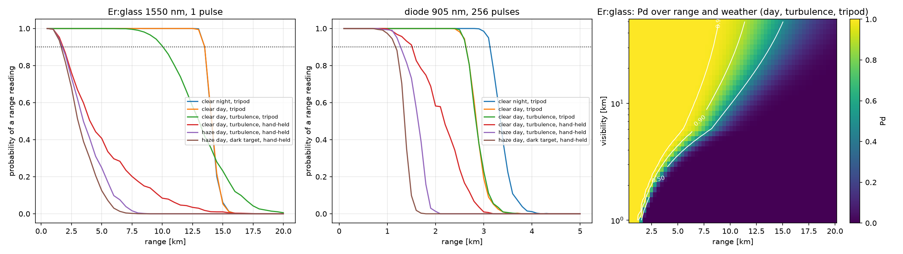
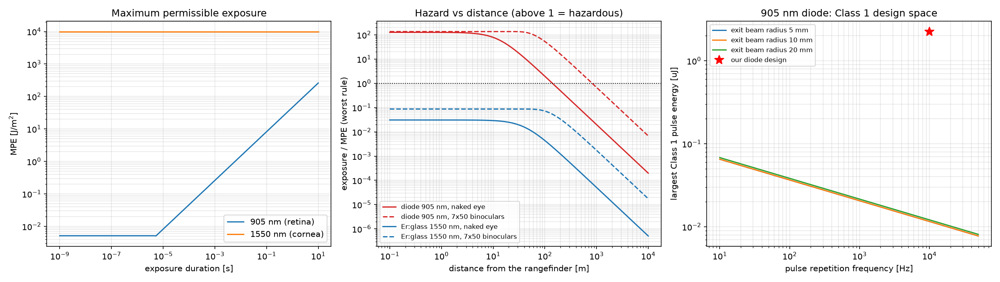
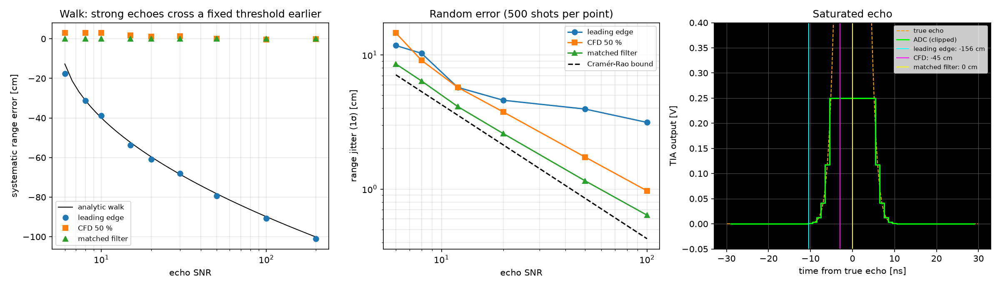
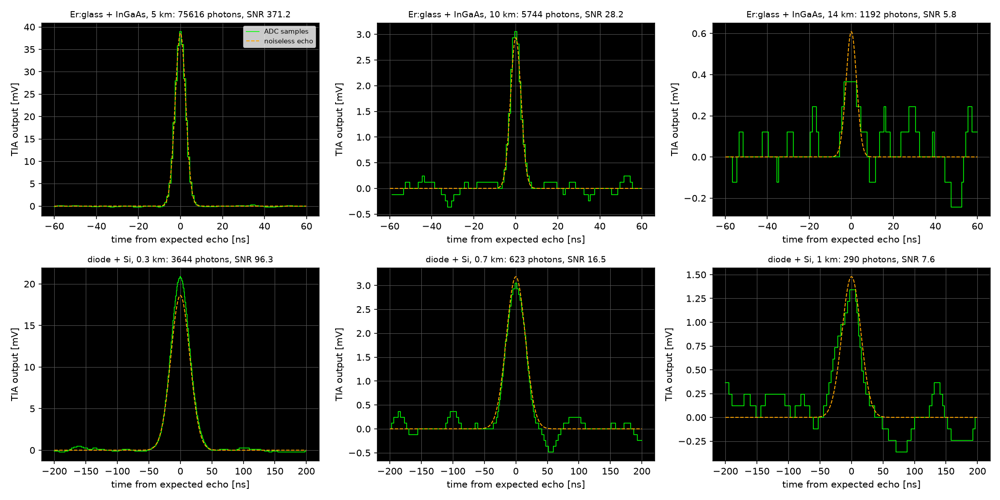

# laser-rangefinder — pulsed laser rangefinder simulator


End-to-end physics simulation of a pulsed time-of-flight laser rangefinder (LRF), from the
transmitted beam to the range reading and eye safety. Two designs are compared throughout:

| | Er:glass 1550 nm | Laser diode 905 nm |
|---|---|---|
| Pulse | 5 mJ, 5 ns, 1 Hz | 2.25 µJ, 30 ns, 10 kHz |
| Beam divergence (full) | 0.5 mrad | 1.0 mrad |
| Receiver | InGaAs APD, Ø40 mm | Si APD, Ø25 mm |
| Pulses per measurement | 1 | 256 |

Package `lrfsim` · 90 unit tests · 11 experiments · Python 3.11+

## Highlights

- **Range table** (Pd ≥ 0.9 per measurement, Pfa 1e-3, NATO target 2.3 m × 2.3 m, ρ = 0.3,
  Monte Carlo validated against the analytic model within ±0.004):

  | Conditions | Er:glass 1550 nm, 1 pulse | Diode 905 nm, 256 pulses |
  |---|---|---|
  | clear night, tripod | 13.50 km | 3.13 km |
  | clear day, tripod | 13.50 km | 2.63 km |
  | clear day, turbulence, tripod | 10.06 km | 2.63 km |
  | clear day, turbulence, hand-held | 1.81 km | 1.51 km |
  | haze day, turbulence, hand-held | 1.75 km | 1.27 km |
  | haze day, dark target (ρ = 0.1), hand-held | 1.65 km | 1.17 km |

  Turbulence costs the single-pulse Er:glass unit 25 % of its range. The diode is not affected,
  because averaging 256 pulses smooths out scintillation. Hand-held, the narrow 0.5 mrad Er:glass beam
  misses the target. Aiming error, not energy, then sets the range.

- **Eye safety:** at 1 ns – 1 µs the 1550 nm MPE is ~1.95 million times higher than at 905 nm.
  The 5 mJ Er:glass unit is Class 1 with 8× margin (NOHD 0 m, even with 7×50 binoculars).
  The 2.25 µJ diode has a 140 m NOHD (823 m with binoculars) and needs ~194× less energy for Class 1.
  Beam expansion does not help, because the Class 1 telescope condition collects the whole beam.

- **Link budget:** at 3 km the Er:glass echo is ~286 000 photons (−111 dB, of which −98.6 dB is
  the receiver's solid angle A/R²). The diode echo is 17 photons per pulse.

- **Atmosphere:** in haze, 1550 nm keeps 38 % of the light over 2 km round trip vs 17 % at 905 nm.
  With moderate turbulence the echo fades below half in ~35 % of shots at 3 km.

- **Beam divergence:** the best divergence depends on how steady the aim is.
  It is 0.12 mrad on a tripod and ~1.2 mrad hand-held (hit probability 0.45 at 3 km).

- **Range resolution:** 1 ns = 15 cm. The air index alone is a 1.35 m error at 5 km.
  Dithering with 0.3-bin jitter averages quantization down to a 1.1 cm floor.

- **Timing:** leading-edge walk is 83 cm between SNR 6 and 200. CFD keeps the bias within 3 cm.
  The matched filter stays within 1.2–1.5× the Cramér–Rao bound (2.6 cm at SNR 20, 0.6 cm at SNR 100)
  and stays unbiased on a clipped echo, where leading edge is off by 156 cm and CFD by 45 cm.

## Model chain

```
transmitter (Gaussian beam, M²) → pointing jitter → atmosphere (Kim extinction, Rytov scintillation)
→ Lambertian target → receiver optics → APD (McIntyre excess noise, solar background)
→ TIA + filter + 12-bit ADC waveform → threshold (Rice, Pfa) → timing (LE / CFD / matched filter)
→ pulse accumulation, multi-target → Monte Carlo Pd vs range → eye safety (MPE, NOHD, Class 1)
```

## Results






## Modules

| Module | Content |
|---|---|
| `tof` | time of flight, air index, range bin, quantization and dithering |
| `beam` | Gaussian beam, M², power on a square target, pointing jitter |
| `atmosphere` | Kim visibility model, Rytov variance, Andrews–Phillips scintillation, fades |
| `linkbudget` | range equation for a Lambertian target, dB budget, photon count |
| `detector` | APD noise (shot, dark, background, amplifier), optimum gain, solar background |
| `waveform` | pulse, filter, noise PSD, TIA, ADC with clipping |
| `detection` | Rice crossing rate, threshold for a Pfa, Pd with and without fading |
| `timing` | leading edge, CFD, matched filter, walk, Cramér–Rao bound |
| `multipulse` | coherent accumulation, binary k-of-N, multi-target detection |
| `performance` | end-to-end Monte Carlo Pd vs range, range tables |
| `eyesafety` | simplified IEC 60825-1: MPE, limiting aperture, repetitive pulse rules, NOHD, Class 1 |

## Experiments

| # | Question |
|---|---|
| exp01 | How fine can a clock measure range? |
| exp02 | Which beam divergence hits a vehicle most often? |
| exp03 | 905 vs 1550 nm in haze, fog and turbulence |
| exp04 | Where does the light go? (link budget) |
| exp05 | APD gain, noise and SNR vs range |
| exp06 | What the receiver actually sees (waveform, ADC) |
| exp07a | Threshold, false alarms and detection probability |
| exp07b | Timing accuracy of LE, CFD and matched filter |
| exp08 | Pulse accumulation and multiple targets |
| exp09 | Range table under realistic conditions (Monte Carlo) |
| exp10 | Eye safety: MPE, NOHD, Class 1 design space |

## Run

```
python -m venv .venv
.venv\Scripts\activate          # Windows
pip install -e ".[dev]"
pytest -q
python experiments/exp09_performance.py
```

Figures are written to `results/`.

## Limitations

- Educational model, not a certified design or eye-safety tool. The eye-safety module uses the
  conservative N^-0.25 pulse-train rule and assumes continuous firing for 10 s.
- Flat Lambertian target, no speckle, no target depth or slope.
- Log-normal scintillation (weak to moderate turbulence); aperture averaging is not modelled.
- Matched-filter results assume a template identical to the echo shape.
- Component values are typical, not taken from a specific product.

## References

- IEC 60825-1:2014, Safety of laser products
- L. C. Andrews, R. L. Phillips, *Laser Beam Propagation through Random Media*
- I. I. Kim et al., visibility-based atmospheric attenuation model (2001)
- R. J. McIntyre, multiplication noise in avalanche diodes (1966)
- S. O. Rice, mathematical analysis of random noise (1944)